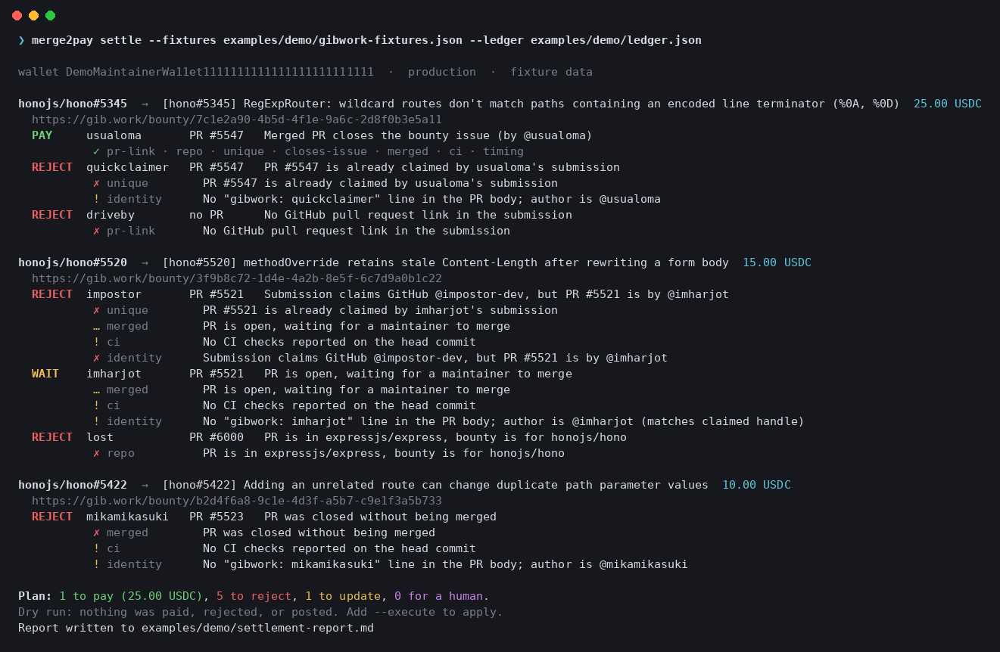

# merge2pay

**Merge-to-pay bounties for Gibwork.** Fund a GitHub issue as a Gibwork bounty, and merge2pay pays the contributor when their pull request is merged. It also rejects copycats, impostors, and dead links, and records why for each one.



Terminal-first. No web app, no dashboard. It is built on the official **Gibwork SDK** (`@gibwork/sdk`) and ships as a **CLI**, a **GitHub Action**, and a read-only **MCP server** for AI agents.

---

## Why this exists

Gibwork already makes it easy to *post* a bounty. The slow, risky part comes later, when submissions arrive and someone has to review and pay.

A Gibwork submission is free text. For a code bounty, a maintainer has to open every one and work out:

- Is there a PR link at all, or just a Google Drive link?
- Is the PR in **my** repo, and does it actually fix **this** issue?
- Is it merged, or still open, or closed without merging?
- Is CI green?
- Did the submitter write it, or did they paste someone else's merged PR?
- Did three people submit the same PR?

Then they pay through a prepare/sign/submit flow and hope a flaky network doesn't make them pay twice.

**merge2pay turns that into one command.** The merge stays the maintainer's decision; merge2pay handles the payment that follows it.

| Without merge2pay | With merge2pay |
| --- | --- |
| Read every submission by hand | `settle` checks every open submission against live GitHub data |
| Copycats submit the same merged PR | First legitimate claim wins; duplicates are rejected with a reason |
| Anyone can paste a famous PR | Identity checks: claimed GitHub handle vs. PR author, optional `gibwork: <user>` proof in the PR body |
| Contributors don't know why they weren't paid | Waiting contributors get one comment per change, saying what is missing |
| Paying twice after a crash | Ledger records the intent before signing; submits are never retried; ambiguous outcomes halt payouts |
| Fat-finger a payout | `maxPayoutPerBounty` and `maxPayoutPerRun` caps in a reviewed policy file |

---

## What it uses from Gibwork

**Toolset: Gibwork SDK** (`@gibwork/sdk@0.2.0`), wallet-authenticated External API.

| merge2pay feature | SDK call |
| --- | --- |
| `fund`: create a bounty from an issue | `tasks.prepareCreate` → `signPreparedTransaction` → `tasks.submitCreate` |
| `fund`: duplicate check | `tasks.listAvailable` (finds live bounties that already link the issue) |
| `link`, `settle`: read the bounty | `tasks.get` |
| `settle`: read submissions | `submissions.list` |
| `settle --execute`: pay the merged PR | `submissions.prepareApproval` → `signPreparedTransaction` → `submissions.submitApproval` |
| `settle --execute`: reject invalid work | `submissions.reject` (with the reason) |
| `settle --execute`: tell a contributor what's missing | `submissions.comments.create` |
| error handling | `GibworkApiError`, `GibworkAmbiguousSubmitError` |

Credentials use the same environment variables as the official Gibwork CLI (`GIBWORK_KEYPAIR_PATH` / `GIBWORK_PRIVATE_KEY`), so an existing setup works unchanged.

---

## Install

Requires Node.js 22+.

```bash
git clone https://github.com/AuraFamerCode/merge2pay
cd merge2pay
npm install          # also builds dist/
npm link             # optional: puts `merge2pay` on your PATH
merge2pay --help
```

Or without cloning: `npm i -g github:AuraFamerCode/merge2pay`.

### Environment variables

| Variable | Needed for | Notes |
| --- | --- | --- |
| *(none)* | `doctor`, `verify`, `fund` (dry run), `link`, `settle --fixtures` | Read-only Gibwork calls are signed with a throwaway in-memory keypair. It is never saved and holds no funds. |
| `GIBWORK_KEYPAIR_PATH` | reading your bounties' submissions, `--execute` | Path to a Solana keypair JSON (`chmod 600`). Same as the official CLI. |
| `GIBWORK_PRIVATE_KEY` | same, for CI | Base58 or JSON array. Use your CI's secret store. Never commit it. |
| `GIBWORK_ENVIRONMENT` | optional | `production` (default) or `stage`. Treat stage as real money too. |
| `GITHUB_TOKEN` | optional | Higher rate limits, private repos, and `fund --comment-issue`. |

merge2pay never reads `.env` files, never accepts a key as a command-line argument, and never prints key material.

---

## Usage

Every command is a **dry run** unless you pass `--execute`.

### 1. `doctor`: check your setup

```
$ merge2pay doctor
  ✓ policy       built-in defaults
  ✓ wallet       Ey1jM5rM7W1XATvnvbP4DihEVo4PTUq3DtNgMkXuyqTF (ephemeral: read-only, nothing can be paid)
  ✓ gibwork api  production: 9 open bounties discoverable via SDK tasks.listAvailable
  ✓ github api   anonymous (public repos only, 60 req/h)
  ✓ ledger       .merge2pay/ledger.json: 0 bounties, 0 payouts
```

### 2. `fund`: turn an issue into a bounty

```
$ merge2pay fund honojs/hono#5520 --amount 15
wallet DeCUjaiT6ydfZCdrbdZ5iJ56brTNwZQGKfgeLwf3ZBWi  ·  production  ·  checked 9 live Gibwork bounties for duplicates

  + honojs/hono#5520             15.00 USDC  [hono#5520] methodOverride retains stale Content-Length after rewriting a form body
      tags Development · min submission 15.00

Plan: 1 bounty to fund.
Dry run: nothing was created or paid. Add --execute to fund.
```

The bounty text it writes tells contributors exactly how to make their claim machine-verifiable: open a PR with `Fixes #5520`, add `gibwork: <username>` to the PR body, and submit the PR URL. Use `--json` to see the exact `CreateTaskInput`.

- `fund --repo owner/repo` funds every open issue with the `gibwork` label. A `bounty:25` label sets the amount.
- `fund ... --execute` shows the SDK's payment quote (amount + platform fee = total debit), asks for confirmation, writes the intent to the ledger, then signs and submits.
- `--comment-issue` posts the bounty link back on the GitHub issue.

Already have bounties? Adopt them instead: `merge2pay link owner/repo#N <taskId>`.

### 3. `verify`: check one PR the way settle would

```
$ merge2pay verify https://github.com/honojs/hono/pull/5547 --issue honojs/hono#5345 --submitter usualoma
PAY  Merged PR closes the bounty issue (by @usualoma)
  ✓ pr-link       https://github.com/honojs/hono/pull/5547
  ✓ repo          honojs/hono
  ✓ unique        First claim on this PR
  ✓ closes-issue  PR says it fixes honojs/hono#5345
  ✓ merged        Merged 2026-10-10
  ✓ ci            19 checks green
  ! identity      No "gibwork: usualoma" line in the PR body; author is @usualoma
  ✓ timing        PR opened after the bounty was posted
```

```
$ merge2pay verify https://github.com/honojs/hono/pull/5523 --issue honojs/hono#5422
REJECT  PR was closed without being merged
  ...
  ✗ merged        PR was closed without being merged
```

### 4. `settle`: pay, reject, or nudge every submission

```bash
merge2pay settle                      # dry run against your ledger
merge2pay settle --report report.md   # plus a Markdown report (also used as the Action's job summary)
merge2pay settle --execute            # apply; prompts with the SDK quote before each payout
merge2pay settle --execute --yes      # CI
```

The screenshot at the top is a real run of:

```bash
merge2pay settle --fixtures examples/demo/gibwork-fixtures.json --ledger examples/demo/ledger.json
```

That demo uses a fixture in place of Gibwork's `submissions.list`, since only the bounty creator's wallet can read submissions. Every PR in it is a **real public `honojs/hono` pull request, checked live on GitHub**. It covers the cases maintainers deal with:

| Submitter | Claim | Verdict |
| --- | --- | --- |
| usualoma | merged PR #5547 that fixes #5345, CI green | **PAY** 25.00 USDC |
| quickclaimer | the same PR #5547, a day later | **REJECT**: already claimed |
| driveby | a Google Drive link | **REJECT**: no PR |
| impostor | PR #5521, claiming to be `@impostor-dev` | **REJECT**: PR is by @imharjot |
| imharjot | their own open PR #5521 | **WAIT**: gets one comment saying it pays on merge |
| lost | a PR in `expressjs/express` | **REJECT**: wrong repository |
| mikamikasuki | PR #5523, closed unmerged | **REJECT**: not merged |

The impostor submitted *before* the real author, and still could not lock them out. A PR only counts as claimed by a submission whose identity check passes.

Exported deliverables from that run: [`examples/demo/settlement-report.md`](examples/demo/settlement-report.md) and [`examples/demo/settlement-plan.json`](examples/demo/settlement-plan.json).

### 5. GitHub Action: settle on every merge

```yaml
# .github/workflows/merge2pay.yml (full file: examples/github-action/merge2pay.yml)
on:
  pull_request: { types: [closed] }
  schedule: [{ cron: '17 * * * *' }]
jobs:
  settle:
    if: github.event_name != 'pull_request' || github.event.pull_request.merged == true
    runs-on: ubuntu-latest
    steps:
      - uses: actions/checkout@v4
      - uses: AuraFamerCode/merge2pay@main
        with: { execute: 'true' }
        env:
          GIBWORK_PRIVATE_KEY: ${{ secrets.GIBWORK_PRIVATE_KEY }}
```

When a maintainer clicks **Merge**, the contributor is paid in that workflow run. The settlement report goes to the job summary, and the ledger is committed back to the repo, so the payout history is in `git log`.

### 6. MCP server: give your agent the judgement

```bash
claude mcp add merge2pay -- merge2pay mcp
```

| Tool | What it does |
| --- | --- |
| `merge2pay_verify_pull_request` | pay / wait / reject / review for one PR + issue, with evidence |
| `merge2pay_plan_settlement` | the full settlement plan, as JSON or Markdown |
| `merge2pay_draft_bounty` | the exact `CreateTaskInput` for an issue, plus live duplicates |
| `merge2pay_ledger` | funded issues, decisions, payouts |

Every tool is **read-only** by design. The agent gets the verification. Money still moves through the official Gibwork MCP's prepare → confirm → submit flow, or `merge2pay settle --execute`. Pair the two: *"Use merge2pay to check the submissions on my bounty, then pay the one it approves with gibwork."*

---

## Policy

Put a `merge2pay.yml` in your repo, so payout rules change through code review. All fields are optional; see [`merge2pay.example.yml`](merge2pay.example.yml).

```yaml
requireMerged: true            # pay merged PRs only
requireChecks: not-failing     # success | not-failing | ignore
requireIssueReference: true    # PR must say "Fixes #N"
requireIdentityProof: false    # PR body must contain "gibwork: <submitter>"
rejectPreBountyWork: false     # PRs opened before the bounty: warn (default) or reject
maxPayoutPerBounty: "100"
maxPayoutPerRun: "250"
autoReject: true
commentOnWait: true
```

---

## How it decides

For every open submission on every funded bounty:

| Check | Pass | Otherwise |
| --- | --- | --- |
| `pr-link` | submission contains a GitHub PR URL | reject |
| `repo` | PR is in the bounty issue's repo | reject |
| `pr-exists` | GitHub returns the PR | reject |
| `unique` | no earlier *legitimate* claim, never paid before | reject |
| `closes-issue` | PR title/body uses a closing keyword for the issue | reject (or review if relaxed) |
| `merged` | merged | open → wait · closed → reject |
| `ci` | check runs + commit statuses green | open → wait · merged → review |
| `identity` | claimed handle = PR author; `gibwork:` line = submitter | mismatch → reject · missing → warn (or review) |
| `timing` | PR opened after the bounty | warn (or reject) |

Then per bounty: the earliest qualifying submission is paid; any other qualifying one goes to a human. Payouts over a cap go to a human. A bounty with an unresolved payment intent is never planned for payment until it is reconciled.

## Architecture

```
            ┌──────────────┐   tasks.get / submissions.list / listAvailable
 Gibwork ◄──┤  gibwork.ts  │   prepare* → sign → submit*, reject, comments
   SDK      └──────┬───────┘
                   │ TaskView / SubmissionView          ┌────────────┐
 GitHub  ◄── github.ts (PRs, issues, checks, statuses) ─┤ verify.ts  │ one submission → Verdict + evidence
 REST                                                    └─────┬──────┘
                   ┌──────────────┐                            │
 merge2pay.yml ───►│  policy.ts   │──────────────►  plan.ts  ◄─┘  bounty → actions (approve/reject/comment)
                   └──────────────┘                    │
 .merge2pay/ledger.json ◄── ledger.ts ◄── execute.ts ◄─┘  intent persisted before signing, no retries
                                                       │
                     cli.ts · action.yml · mcp.ts ◄────┘  render.ts → terminal + Markdown report
```

| File | Role |
| --- | --- |
| `src/claims.ts` | Parse PR/issue links, closing keywords, identity markers out of HTML |
| `src/github.ts` | Small cached GitHub REST client (anonymous or `GITHUB_TOKEN`) |
| `src/gibwork.ts` | SDK wrapper: live (keypair / ephemeral read-only) or fixtures |
| `src/verify.ts` | The verifier: nine checks → pay / wait / reject / review |
| `src/plan.ts` | Two-pass settlement planning (identity-aware uniqueness), caps |
| `src/execute.ts` | Applies the plan with quotes, confirmations, ledger-first writes |
| `src/fund.ts` | Issue → `CreateTaskInput` with verifiable claim instructions |
| `src/mcp.ts` | Read-only MCP server |

## Tests

```bash
npm test
```

36 tests, no network: parsing, every verifier rule, impostor/duplicate handling, caps, the WAIT-comment dedupe, ledger-before-submit ordering, halting on `GibworkAmbiguousSubmitError`, never paying without confirmation, and the MCP server over an in-memory transport.

## Limits and honest notes

- Reading a bounty's submissions needs the creator's wallet. That is a Gibwork permission, and the right one. Without it, `settle` reports that clearly and still verifies everything else.
- The `identity` check is only as strong as its inputs. Requiring the `gibwork: <user>` line (`requireIdentityProof: true`) is the strict mode.
- Closing references are read from the PR title/body (GitHub's own keywords). Issues linked only through the GitHub sidebar are not detected yet.
- Other builders report that Gibwork stage settles in real mainnet USDC, with a 1 USDC minimum bounty. Treat stage as real money: start with `--env stage` and small amounts.

## Roadmap

- Partial payouts split by `Co-authored-by` trailers
- Refund on `not planned` issue closes (`tasks.refund`)
- GitHub App mode with webhook-driven settlement

## License

MIT © 2026 Kanish Patidar
